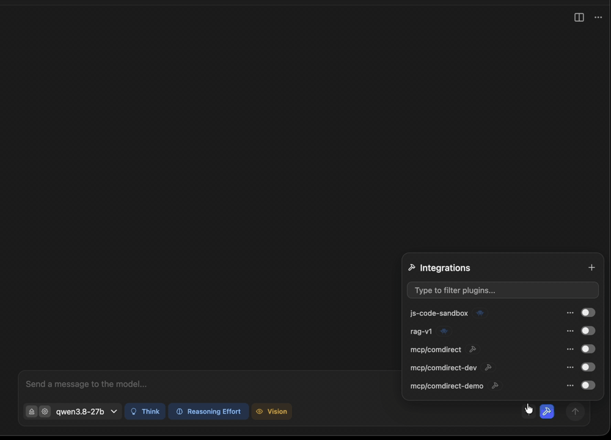

# comdirect-mcp

<!-- mcp-name: io.github.mad4ms/comdirect-mcp -->

[](https://pypi.org/project/comdirect-mcp/)
[](https://pypi.org/project/comdirect-mcp/)
[](https://github.com/mad4ms/comdirect-mcp/actions/workflows/tests.yml)
[](https://modelcontextprotocol.io/specification/2026-07-28)
[](LICENSE)

**Read-only [MCP](https://modelcontextprotocol.io) server and typed Python client for the
[comdirect REST API](https://www.comdirect.de/cms/kontakt-zugaenge-api.html).** Let Claude, GitHub Copilot or a
local model look at your accounts, transactions, depot and postbox. You approve the login in the photoTAN app, and
no tool can move money.



> [!WARNING]
> Unofficial, not affiliated with comdirect. It handles your banking credentials, and every tool result goes to the
> model behind your MCP client: with a cloud assistant your financial data leaves your computer. For the most
> privacy [use a local model](docs/how-to/use-a-local-model.md). See [SECURITY.md](SECURITY.md).

## Warnung (auf Deutsch, weil comdirect)

Leute, hier geht es um euer Geld. Nutzt das nur, wenn ihr den Code versteht und die Risiken kennt. MIT-Lizenz:
Jeder darf damit machen, was er/sie will (auch ihr, comdirect 👀), aber ohne Gewährleistung und ohne Haftung.

Transparenz: Ein Teil des Codes stammt von Opus 5.5 und gpt-6.1-sol, ich habe reviewed, getestet und weise
genickt. Genau deshalb: Code verstehen.

Der Server nutzt nur lesende Endpunkte, aber Fehler passieren trotzdem: comdirect kann die API ändern,
Dependencies können kompromittiert werden, und 2FA ist kein Freifahrtschein. Deshalb:

- Nur lokal auf dem eigenen Rechner nutzen, Zugangsdaten niemandem geben.
- Zugangsdaten in den OS-Schlüsselbund (`comdirect-mcp configure`). Eine `.env` enthält das Passwort im Klartext:
  niemals committen.
- Updates nicht blind einspielen: Version pinnen, Änderungen anschauen.

**MCP-Server**: Hängt ihr ihn an einen Cloud-Client, **verlassen eure Daten euren Rechner** und können in Logs
landen. Verwendungszwecke und Dokumente können Prompt-Injections enthalten. Also nur in Umgebungen nutzen, denen
ihr vertraut.

Wer seine Kontoauszüge eh schon in ChatGPT kopiert: Macht, was ihr wollt, aber **auf eigene Verantwortung**!

## Features

- **Safe login**: push TAN confirmed in your client; stops before comdirect's lock after five unconfirmed
  challenges; revokes the session on logout and shutdown
- **Credentials in the OS keychain**, read-only tools with truthful annotations
- **Answers on the server**: cash flow and spending per month, counterparty or your own
  [categories](docs/how-to/categorize-transactions.md), subscriptions with yearly costs, portfolio allocation
- **Clean data**: transfers between your own accounts are kept out of spending, PayPal payments show the merchant,
  payment texts are cleaned up, IBANs masked
- **Typed Python client** for your own scripts

The API returns account transactions of the last 180 days only.

| Tool | |
| --- | --- |
| `login` / `logout` | Start a session (push TAN) / end and revoke it |
| `list_accounts`, `list_cards`, `get_wealth_overview` | Balances of accounts, cards and all products |
| `list_transactions` | Individual transactions |
| `summarize_transactions` | Income, expenses and net per month, counterparty, type or category |
| `find_recurring_payments` | Subscriptions, contracts and standing orders |
| `list_depots`, `get_depot_positions`, `summarize_portfolio` | Depot positions and allocation |
| `list_depot_transactions`, `list_orders`, `get_order`, `get_instrument` | Securities movements, order book, security data |
| `list_documents`, `read_document` | Postbox documents as text or PDF (reading marks them as read) |

Prompts: `monthly_review`, `find_subscriptions`, `tax_documents`. Details: [Tools reference](docs/reference/tools.md).

## Quickstart

You need [uv](https://docs.astral.sh/uv/), comdirect API access
([Client ID and Secret](docs/how-to/get-comdirect-api-access.md)) and photoTAN Push as default TAN method.

```bash
uvx comdirect-mcp@0.6.1 configure   # stores your credentials in the OS keychain
```

Add the server to your client, e.g. Claude Code:

```bash
claude mcp add --transport stdio --scope user comdirect -- uvx comdirect-mcp@0.6.1
```

or Claude Desktop, LM Studio and others:

```json
{
  "mcpServers": {
    "comdirect": {
      "command": "uvx",
      "args": ["comdirect-mcp@0.6.1"]
    }
  }
}
```

Then ask, e.g. *„Welche Abos zahle ich, und was kosten sie im Jahr?“* The assistant calls `login` and you approve
the push in the app. VS Code, Ollama and more: [Configure MCP clients](docs/how-to/configure-mcp-clients.md) ·
step by step: [Getting started](docs/tutorials/getting-started.md) · problems: [Troubleshoot](docs/how-to/troubleshoot.md).

## Python library

```python
from comdirect_mcp import ComdirectClient
from comdirect_mcp.utils import default_push_tan_callback

client = ComdirectClient(
    {"client_id": "...", "client_secret": "...", "username": "...", "password": "..."},
    {"push_tan_cb": default_push_tan_callback},
)
client.login()  # approve the push TAN, then press Enter
for account in client.list_accounts():
    print(account.id, account.balance, account.currency)
```

See [Use the Python library](docs/how-to/use-the-python-library.md).

## More

[Documentation](docs/README.md) · [CHANGELOG](CHANGELOG.md) · [CONTRIBUTING](CONTRIBUTING.md) ·
[AGENTS.md](AGENTS.md) for AI coding agents · [MIT License](LICENSE)
