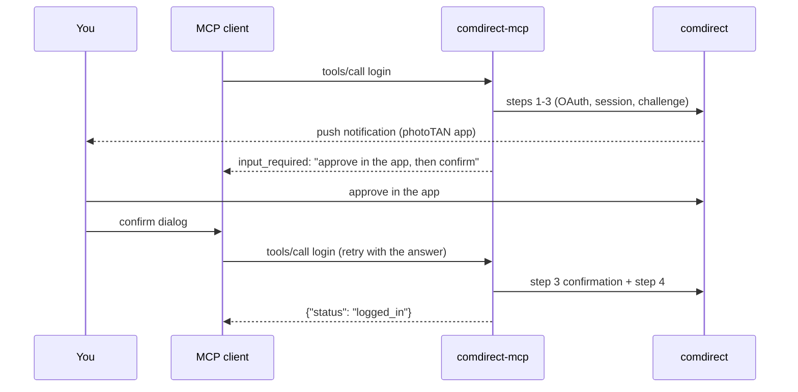

# Login and sessions

## What comdirect requires

A comdirect API session is created in four steps:

1. **OAuth password grant** with Client ID/Secret, Zugangsnummer and PIN → primary token
2. **Session** created for that token
3. **2FA challenge** for the session → the user approves it (photoTAN push) or enters a TAN
4. **Secondary token** (`cd_secondary` grant) → the access token for all data requests

The access token is valid for 10 minutes. The client refreshes it shortly before it expires with the refresh
token; the session TAN stays valid as long as the tokens do. When the refresh token has expired, a new login (with
a new 2FA approval) is needed. Source: comdirect's *REST API – Schnittstellenspezifikation* (April 2020),
chapters 2 and 3.

## How the MCP server maps this

- **Explicit login.** Only the `login` tool starts a session. Data tools fail with "call `login`" instead of logging
  in implicitly, so no tool call triggers a 2FA push behind your back.
- **Elicitation.** The user confirms the approval in a dialog of the MCP client. With the 2026-07-28 protocol this
  is a *multi round-trip request*: the server answers `input_required`, the client asks the user and retries the
  call with the answer. Older clients get a regular `elicitation/create` request during the call. The server keeps
  the started challenge between the rounds, so the push is sent only once.
- **Fallback.** Clients without elicitation support get a fixed approval window
  (`COMDIRECT_MCP_PUSH_TAN_WAIT`, default 30 s). There is no way to ask comdirect whether the push was approved,
  so the server cannot poll; confirming too early makes the confirmation fail.
- **Clients that decline without asking.** Some clients declare elicitation but decline or cancel the dialog within
  milliseconds without showing it (Claude Code 2.1.296). An answer faster than one second cannot come from a person
  who read the dialog, so the server treats it like a missing dialog and uses the approval window. A decline after
  that, or a form submitted without ticking *Freigegeben*, stops the login.
- **The TAN never reaches the model.** The dialog is between client and user; the model only sees the tool result.
- **Push is requested explicitly.** The challenge request asks for `P_TAN_PUSH`, and the confirmation omits the
  TAN header as the API documentation specifies for push approvals.

## Protection against account locks

comdirect locks the online banking access after five TAN challenges without a confirmed TAN in between. A model
that calls `login` again and again (e.g. because the user does not approve) could trigger that. The server
therefore counts unconfirmed challenges and refuses new logins after three; a confirmed login resets the count.
Because comdirect's counter is only reset by a confirmed TAN, the user has to log in once on comdirect.de and
restart the server to continue.

## Why only photoTAN Push

SMS-TAN and the photoTAN graphic require the user to type a TAN. The MCP specification forbids requesting
sensitive information through form elicitation, and passing the TAN through the model would be worse. Push
approval needs no secret input, only a confirmation, which fits elicitation exactly. The Python library supports
all three methods through callbacks.

## Session lifetime

The server keeps one session per process in memory. It ends when you call `logout` or when the MCP client stops
the server, or when the tokens expire after inactivity. Tokens are never written to disk.

On `logout` and on shutdown the server calls `DELETE /oauth/revoke`, as the API documentation asks applications
to do when they end. The documentation says this invalidates access token, refresh token and session TAN. A live
test showed a narrower effect: comdirect answers `204`, the refresh token is rejected immediately (`400`), but the
last access token keeps working until it expires. So after a logout the session cannot be extended and ends at
the latest 10 minutes later.
